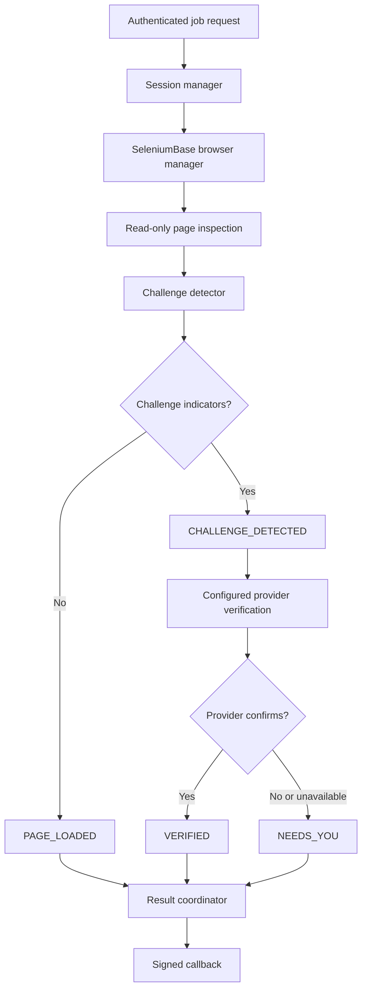

# Server 2 architecture

Server 2 is a standalone browser-diagnostics and provider-verification service.

## Flow

## Modules

- `app/browser/seleniumbase_manager.py`: standard SeleniumBase lifecycle.
- `app/browser/session_manager.py`: in-memory session metadata registry.
- `app/detection/evidence.py`: normalized evidence structure.
- `app/detection/detector.py`: passive challenge classification.
- `app/captcha/challenge_state.py`: allowed state transitions.
- `app/captcha/result_validator.py`: validates provider-confirmed outcomes.
- `app/providers/`: provider adapter contracts and registry.
- `app/orchestration/coordinator.py`: detection-to-state coordination.
- `app/orchestration/callback.py`: signed callback wrapper.

## Deliberate scope

This repository does not include UC/stealth configuration or CAPTCHA-clicking/bypass logic. Browser inspection is for controlled QA and diagnostics. A challenge is not considered verified because a browser method returned; only a provider-confirmed result can be marked verified.

The session registry is in-memory and must be replaced by durable storage before production.
