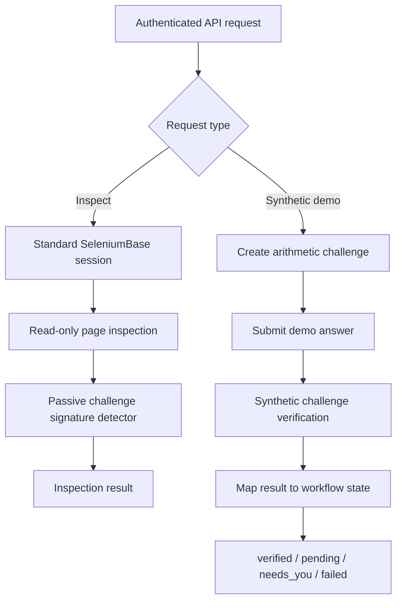

# Server 2 architecture

Server 2 is a standalone browser-diagnostics and synthetic workflow demonstration service.

## Current implemented flow

## Modules

- `app/browser/seleniumbase_manager.py`: standard SeleniumBase lifecycle.
- `app/browser/inspector.py`: read-only page inspection.
- `app/detection/`: passive provider-signature classification and evidence.
- `app/demo/service.py`: local arithmetic challenge lifecycle.
- `app/captcha/challenge_state.py`: workflow state vocabulary and transitions.
- `app/orchestration/coordinator.py`: page classification and synthetic result mapping.
- `app/providers/`: provider adapter contracts and registry; no adapters are registered by default.
- `app/integrations/rejekt.py`: signed HTTPS callback helper; not yet connected to a job endpoint.

## Explicitly not implemented

- UC/stealth mode.
- Pure CDP browser manager.
- SeleniumBase `solve_captcha()` invocation.
- Third-party CAPTCHA solving or anti-bot bypass.
- Real provider adapters or provider credentials.
- Durable jobs, sessions, or Redis queue.
- End-to-end Rejekt job intake and callback orchestration.

The arithmetic demo is synthetic and is not a real CAPTCHA or a security control. A browser inspection result is never treated as proof of provider verification.

## Local testing

Set `CAPTCHA_DEMO_ENABLED=true`, start the FastAPI app, create a demo challenge, and submit the displayed arithmetic answer to its verification endpoint. Tests use synthetic values and do not contact CAPTCHA providers.
